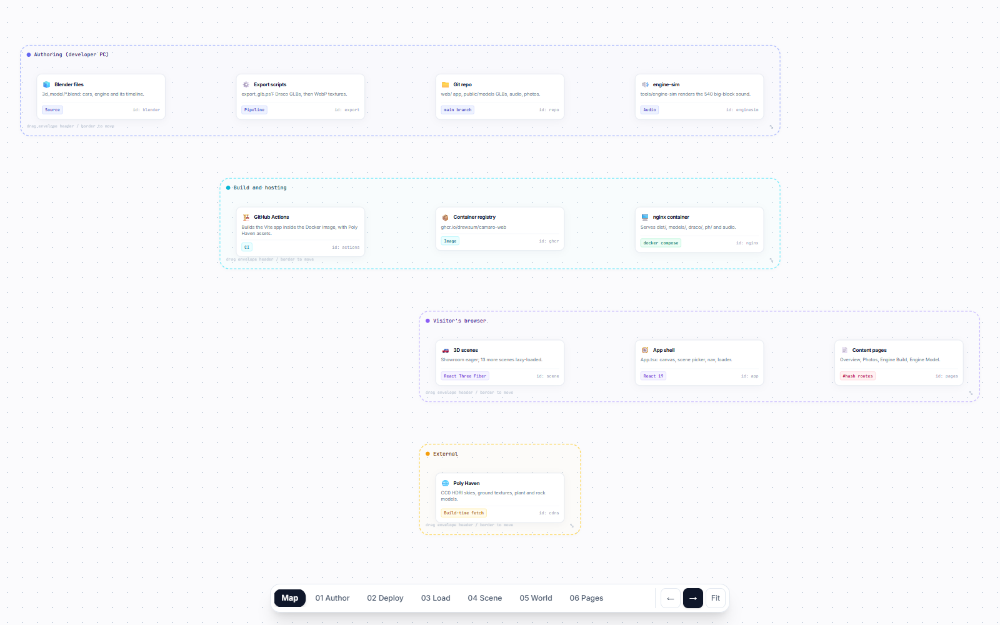

# 1968 Camaro web viewer

Interactive 3D viewer for a 1968 Camaro SS model (React Three Fiber, served by nginx in Docker).

## Layout

[](https://drewsum.github.io/camaro_web_page/architecture.html)

How a model gets from Blender to a visitor's screen, in six steps:

1. **Author:** `3d_model/*.blend` files are exported to Draco-compressed GLBs (car textures
   re-encoded as WebP), and `tools/engine-sim` renders the engine-sound MP3 loops. Both are
   committed under `web/public/`.
2. **Deploy:** a push to `main` runs GitHub Actions, which builds the Vite app into an nginx
   image on ghcr.io and points the `deploy` branch at it; Portainer redeploys from that branch.
3. **Load:** the browser fetches the page and JS bundle; `index.html` preloads `camaro.glb`
   and the Draco decoder at the same time.
4. **Scene:** the app shell (`web/src/App.tsx`) mounts the chosen scene. The showroom ships in
   the main bundle; the other 13 scenes are lazy-loaded along with any extra car GLBs.
5. **World:** outdoor scenes load HDRI skies, ground textures and props from Poly Haven (CC0).
   The image build fetches them (`web/scripts/polyhaven.mjs`, listed in
   `web/src/scenes/common/polyHavenAssets.json`), re-encodes textures as WebP and gzips the
   rest, and nginx serves them under `/ph/`. `npm run dev` fetches them too, once.
6. **Pages:** Overview, Photos, Engine Build and Engine Model open over the viewer via the URL
   hash. Hovering Engine Model prefetches its 8 MB GLB.

Click the image for the [interactive version](https://drewsum.github.io/camaro_web_page/architecture.html) (drag cards, step through each flow with
the arrow keys), served by GitHub Pages from [`docs/architecture.html`](docs/architecture.html).

## Update the model

The site serves `web/public/models/camaro.glb`, exported from `3d_model/camaro.blend`.
After editing the .blend, re-export (uses Blender 5.2; override the path with `$env:BLENDER`):

```powershell
./scripts/export_glb.ps1
```

The same script exports the engine for the Engine Model page: `3d_model/engine/bbc_block_work.blend`
-> `web/public/models/engine.glb` (`scripts/export_engine_glb.py`). The car GLBs are then
passed through `web/scripts/optimize-glb.mjs`, which re-encodes their PNG textures as WebP
(lossy only for colour maps; normal and data maps stay lossless). Each top-level `BBC_*`
collection in the .blend becomes a tickbox on the page; give new ones a label in
`PART_LABELS` in `web/src/pages/EngineModel.tsx`.
The .blend's timeline (one four-stroke cycle driven by the crank's `crank_deg`) is baked
into the GLB as the animation the page plays.

## Local development

```powershell
cd web
npm install   # also copies the Draco decoder into public/draco
npm run dev
```

## Deploy

The server runs a Portainer **Git-repository stack** from `deploy/portainer-compose.yml` with
**GitOps updates**; nothing is built on the server and no Watchtower is needed.

```
push to main ──► Actions (.github/workflows/release.yml): build + push ghcr.io/drewsum/camaro-web:sha-<short>
                   └─► commit "deploy: sha-<short> [skip ci]" (rewrites the image: line in
                       deploy/portainer-compose.yml) to main, and move the deploy branch to it
Portainer polls the deploy branch ──► sees the new commit ──► pulls the image, redeploys
```

Portainer tracks `deploy`, which only ever points at a tag-bump commit, so it never redeploys
before the image it names exists. Don't commit to `deploy` by hand; the workflow moves it.

**Setting up the stack** (Portainer → Stacks → Add stack → Repository):

- Repository URL `https://github.com/drewsum/camaro_web_page`, reference `refs/heads/deploy`,
  authentication off (the repo and the GHCR package are public).
- Compose path `deploy/portainer-compose.yml`.
- GitOps updates on: mechanism *Polling*, interval `5m`; **Re-pull image** on, **Force
  redeployment** off.
- Environment variables (optional): `PORT` for the host port (default 8080).

**Rolling back:** revert the commit on `main` (a new image is built and deployed), or set
`CAMARO_IMAGE=ghcr.io/drewsum/camaro-web:sha-<older>` in the stack's environment and update
it. Every `sha-` tag stays in GHCR.

To build and run locally instead:

```sh
docker compose up -d --build
```

Serves on port 8080 by default; set `PORT` to change the host port.

## Model license

Based on a 1967 model, modified to 1968 specification (split tail lights, side marker lamps,
no vent windows, wheel well trim, cowl hood, paint and trim changes).

"1967 Chevrolet Camaro SS 350 Coupe" (https://skfb.ly/pNoxx) by Ddiaz Design, licensed under
CC BY-NC-SA 4.0 — see `3d_model/LICENSE.txt`.
